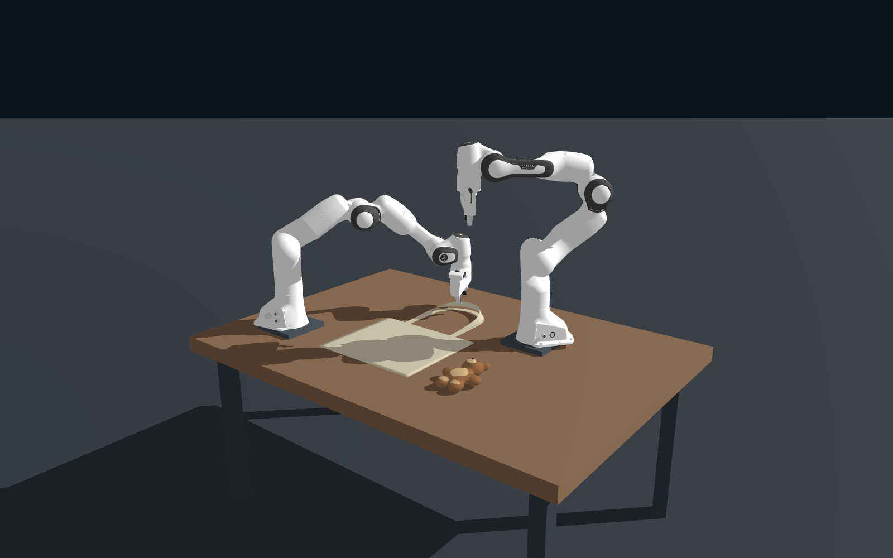
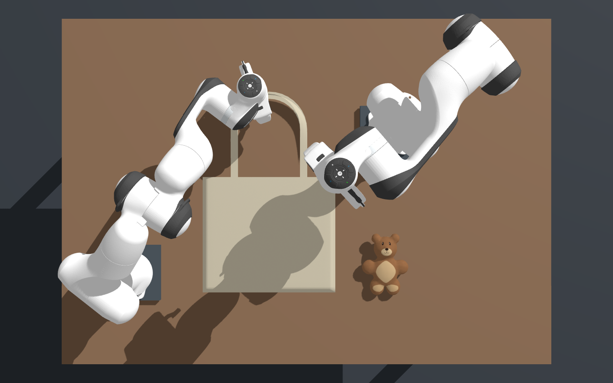
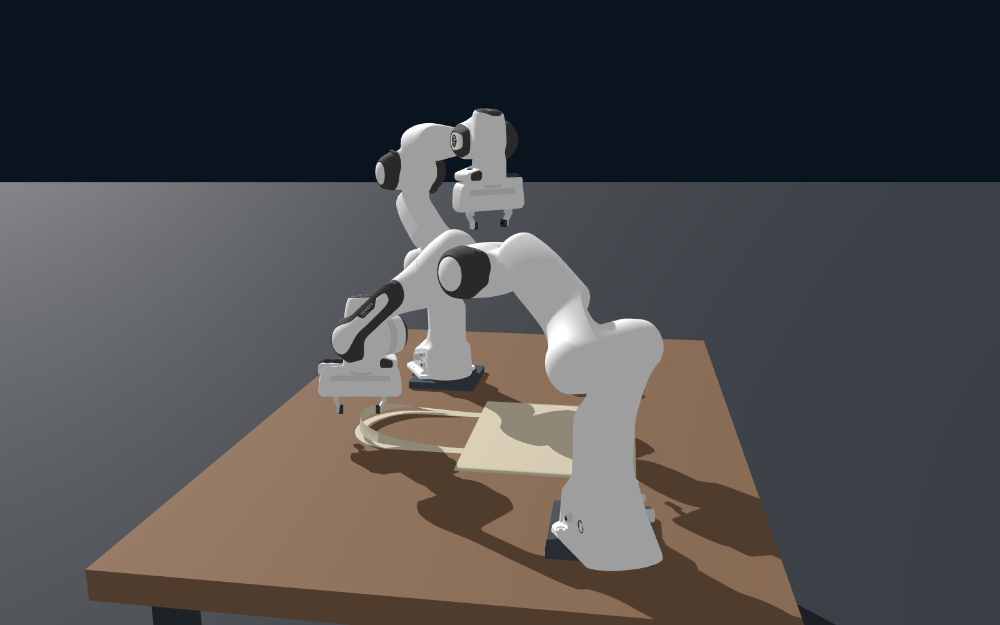
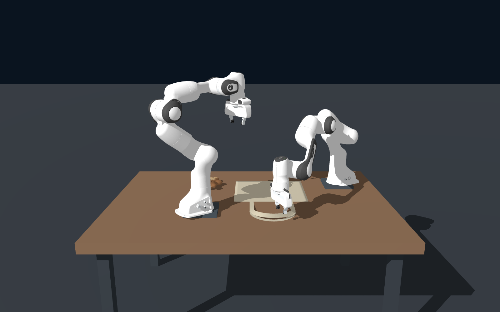

# Genesis 双 Franka：平放布袋与软体玩具熊

保存当前完整操作记录：布袋平放在桌上，左臂夹住一根提带并提起布袋，右臂抓起软体熊、移动到袋口，最后按指令直接张开夹爪并停止。袋子由两片布沿侧边和底边缝合，没有箱形底面；使用可变形布料与软体接触仿真。

**最新结果：松手动作已经完成。** 右夹爪两指实际位置约为 0.039992 m / 0.039995 m；最后松手不以熊的质心或入袋比例作为前提。此结果不代表已经验证熊完全装入袋中。详见 [结果记录](media/release-result.json)。

## 视频和 initial 4 views

- [完整流程视频（57.6 秒，含最后松手）](media/full-process.mp4)
- [最后松手片段](media/direct-release.mp4)
- [松手后的近景](media/release-final-detail.png)
- [四张初始图与相机记录](media/initial_views/)

| 斜前方 | 俯视 |
| --- | --- |
|  |  |
| 侧面 | 背面 |
|  |  |

这四张图使用之前熊穿衣项目 [four-view-genesis 的相机参数](https://github.com/Chloe-Jinlei/four-view-genesis/blob/049bc52b471baf13e6a949e5ad5015d115927560/simulate.py#L119-L128)：相同位置、朝向、视场角，分辨率提高到 1600×1000，保留原 8:5 比例。图像来自当前仿真的同一个 time=0 状态；导出时未推进物理。侧面视角中机械臂遮挡了熊，背面有部分遮挡，未为构图移动实体。历史视频保留运行时原有的主相机视角。

## 记录的流程及恢复边界

视频由实际仿真渲染片段拼接，包含以下来源；它不是一次没有中断的连续计算。

| 片段 | 视频范围 | 来源与恢复方式 |
| --- | --- | --- |
| 初始、提袋、抓熊、移动到袋口 | 0–47.30 s | `flat_full_17`，取前 946 帧，源状态至约 46.815 s |
| 入袋调整 | 47.30–52.75 s | `final_stage_18`，由保存位置与估计速度重新初始化 |
| 袋口调整 | 52.75–56.70 s | `final_stage_19`，恢复 stage 18 原生 IPC 保存状态 |
| 直接松手并停止 | 56.70–57.60 s | `final_stage_20`，恢复 stage 19 原生 IPC 保存状态，计算 0.8 s |

原始 `flat_full_17` 后续曾触发接触力矩限制，完整原始报告保留在数据包中；该失败尾段未放进最新拼接视频。stage 18 也保留了原始停止/恢复记录。stage 19/20 恢复了原生 IPC 位置、速度和保存的接触历史，但 Genesis 刚体求解器缓存等状态需要重建，因此不声称跨进程的整个场景逐位连续。流程和文件校验信息见 [workflow.json](workflow.json)。

## 获取代码、运行环境和保存状态

代码、最终模型、纹理、视频及初始图片在 Git 中。较大的引擎源码、原生库和完整运行证据在 [v1.0.0-direct-release](https://github.com/Chloe-Jinlei/genesis-franka-cloth-bag-release/releases/tag/v1.0.0-direct-release)；下载脚本按 [SHA-256 清单](environment/release-assets.json) 验证文件。

要求：Linux x86_64、CPython 3.12、glibc ≥ 2.34、支持所需 CUDA 版本的 NVIDIA GPU/驱动，以及 EGL/OpenGL。此版本在 RTX 5070 Laptop GPU 上运行。使用 Genesis 1.4.3（源码提交 `ffd119c30118ebb9745fc009349efb2112a8cb76`）、pyuipc 0.0.29、Torch 2.14.0+cu130；原生 pyuipc 组件基于 CUDA 12.8 构建。Python 包版本记录在 [锁定清单](environment/python-packages.lock)。

先安装 [uv](https://docs.astral.sh/uv/getting-started/installation/)，然后：

```bash
git clone https://github.com/Chloe-Jinlei/genesis-franka-cloth-bag-release.git
cd genesis-franka-cloth-bag-release
bash scripts/setup_environment.sh
.venv/bin/python scripts/fetch_release.py --group evidence
.venv/bin/python scripts/restore_runtime.py --group evidence
```

恢复后四个原始运行目录位于 `teddy_bag_flat_start/runs/`，包括保存状态、配置、命令、报告、原始渲染片段和当时的源代码副本；stage 18–20 的原生保存状态放在各运行目录下的 `native_workspace/`。历史报告保留原机器路径作为来源记录；恢复代码优先使用仓库内相对路径。

## 运行与重新导出

从已经发布的 stage 19 保存状态重新执行最后松手：

```bash
./run.sh release --output runs/repeated_release
```

从初始状态运行 Full17 原始自动流程：

```bash
./run.sh --task full --config config.json --output fresh_full17
```

这个入口的输出保存在 `teddy_bag_flat_start/runs/fresh_full17/`。它运行原始自动控制器，仍可能在接触限制处停止；它不会自动接上后续交互调整。复现记录的调整命令可用：

```bash
./run.sh recorded --stage all --output runs/recorded_stages --dry-run
./run.sh recorded --stage all --output runs/recorded_stages
```

`18`、`19`、`20` 或 `all` 各自从发布的对应源状态开始，`all` 不会把新算的 stage 18 输出当作 stage 19 输入。触发物理限制会保留非零退出状态；这不是把限制停止伪装为成功的回放。

重新导出四个初始视角（需要 GPU，不执行物理步）：

```bash
.venv/bin/python scripts/render_initial_views.py --output runs/new_initial_views
```

环境检查：

```bash
.venv/bin/python scripts/check_environment.py --gpu
```

已在当前机器检查文件完整性、资源路径、机器人模型与四视角初始状态一致性，并实际执行了记录中的松手动作。没有在另一台干净机器上验证全新安装，也不保证不同 GPU/驱动下的动力学逐位一致。

## 物理模型与文件范围

布袋采用薄壳布料、两片布共享 U 形缝边，底部没有额外宽度；当前等效参数为 E=10 MPa、弯曲刚度 1e-5、摩擦系数 0.65。玩具熊采用可变形实体模型，E=18 kPa。参数用于近似柔软、较难拉伸的棉麻布与填充玩具，并非实物材料标定。完整参数以 [config.json](teddy_bag_flat_start/config.json) 和原生材质初始化代码为准。

仓库包含当前流程所用模型和冻结源码，以及更早的建模辅助脚本。运行现有场景无需重新生成模型。`build_flat_bag.py` 的历史输入已随模型提供；早期其他建模脚本仅保留作来源记录。公开包没有包含所有历史失败尝试、虚拟环境或用户原始参考照片。

第三方许可证保留在 [third_party](third_party/)、[Franka 模型目录](teddy_bag_flat_start/assets/franka_meshes/) 及各依赖发布包中。
